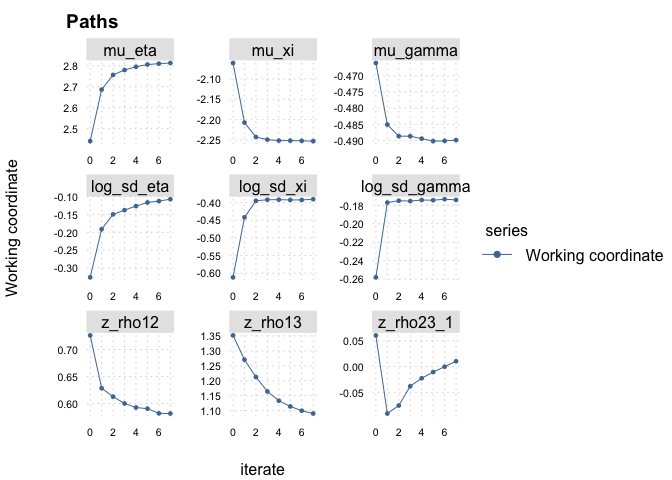
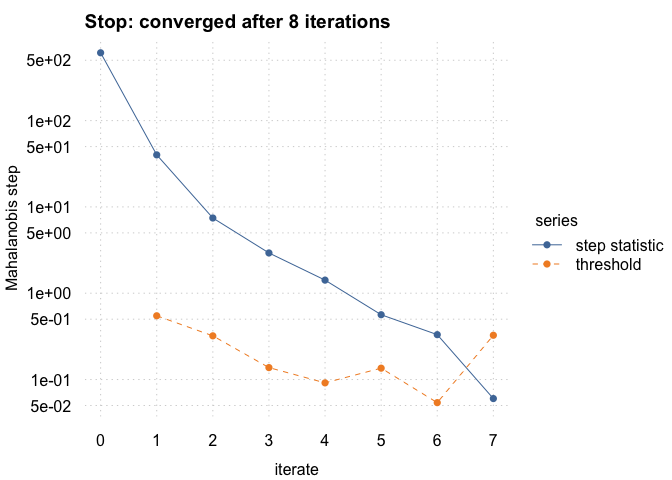

<!-- README.md is generated from README.Rmd. Please edit that file -->

# accmeta

<!-- badges: start -->

[](https://lifecycle.r-lib.org/articles/stages.html#experimental)[](https://github.com/giuseppealfonzetti/accmeta/actions/workflows/R-CMD-check.yaml)
<!-- badges: end -->

Penalised estimation of meta-analysis models for diagnostic accuracy, in
terms of sensitivity and specificity (bivariate model) or sensitivity,
specificity and prevalence (trivariate model), combining cohort and
case-control studies. Three estimators are available: a linear mixed
model (LMM) using a within-study normal approximation, the generalized
linear mixed model (GLMM), and an iterative bootstrap (IB) that corrects
the bias of the LMM by simulating from the GLMM. All are fitted through
`fit_meta_model()`, with the estimator’s options set by `set_control()`.
IB fits come with a covariance matrix and Wald or basic confidence
intervals, built from a simulated Jacobian of the TGLMM score.

## Installation

You can install the package via

``` r
pak::pkg_install("giuseppealfonzetti/accmeta")
```

## Example

Setup true parameter value

``` r
library(accmeta)

th <- c(2.94, -2.2, -0.4, 0.0953, 0.4, -0.5108, 0.3, 0.2, -0.6931)
theta2list(th)
#> $MU
#>   eta    xi gamma 
#>  2.94 -2.20 -0.40 
#> 
#> $SIGMA
#>             eta        xi     gamma
#> eta   1.2099754 0.4399955 0.3299966
#> xi    0.4399955 0.5200184 0.2400031
#> gamma 0.3299966 0.2400031 0.3800236
min(eigen(theta2list(th)$SIGMA)$values)
#> [1] 0.2000188
```

Simulate data from true model

``` r
set.seed(1)
x <- sim_data(15, th, sample(40:200, 15, TRUE))
head(x)
#>      n11 n10 n01 n00
#> [1,]  18   9   4  76
#> [2,]  39   6   2 121
#> [3,]  20   7   0  55
#> [4,]  30   1   3  19
#> [5,]  44   4   1  41
#> [6,]  33   7   7  77
```

Counts go in through `set_meta_data()`, which checks them and computes
the summaries the models need.

``` r
d <- set_meta_data(x)
#> empty cell in studies 3, 7, 10, 13: 'est' and 'wvar' are infinite. Rebuild with CC > 0 if needed.
d
#> <accmeta_data> 15 studies, continuity correction 0 
#>               SE        SP      PREV   n
#> min    0.7272727 0.7500000 0.0738255  46
#> median 0.9516129 0.9111111 0.4166667 112
#> max    1.0000000 0.9722222 0.6814159 168
```

A continuity correction is needed by the approximate model whenever a
cell is empty. You can use the CC argument:

``` r
d_cc <- set_meta_data(x, CC = 0.5)
d_cc
#> <accmeta_data> 15 studies, continuity correction 0.5 
#>               SE        SP      PREV   n
#> min    0.7083333 0.7456140 0.0794702  46
#> median 0.9444444 0.9021739 0.4193548 112
#> max    0.9893617 0.9594595 0.6782609 168
```

Now we can fit the models. Note that the TGLMM can be directly fitted on
the original data.

``` r
tlmm <- fit_meta_model(d_cc, MODEL = "trivariate", ESTIMATOR = "lmm")
tglmm <- fit_meta_model(d, MODEL = "trivariate", ESTIMATOR = "glmm")
ib <- fit_meta_model(d_cc, MODEL = "trivariate", ESTIMATOR = "ib")
ib
#> <accmeta_ib> 6 iterations, stopped on converged 
#>    SE    SP  PREV 
#> 0.940 0.906 0.372
```

`coef()` extract estimated parameters:

``` r
coef(tlmm)
#> $MU
#>        eta         xi      gamma 
#>  2.4407248 -2.0611864 -0.4659761 
#> 
#> $SIGMA
#>             eta        xi     gamma
#> eta   0.5203300 0.2428441 0.4872421
#> xi    0.2428441 0.2941664 0.2370193
#> gamma 0.4872421 0.2370193 0.5966924
coef(tglmm)
#> $MU
#>        eta         xi      gamma 
#>  2.8735389 -2.2437703 -0.4812437 
#> 
#> $SIGMA
#>             eta        xi     gamma
#> eta   0.8528528 0.3144389 0.5883872
#> xi    0.3144389 0.3713802 0.1849338
#> gamma 0.5883872 0.1849338 0.6532612
coef(ib)
#> $MU
#>        eta         xi      gamma 
#>  2.7468931 -2.2684758 -0.5218094 
#> 
#> $SIGMA
#>             eta        xi     gamma
#> eta   0.7831908 0.3876533 0.6321118
#> xi    0.3876533 0.4738952 0.2669153
#> gamma 0.6321118 0.2669153 0.6963463
```

All models are estimated, by default, with the recommended Wishart
prior, whose `DEGREES = NULL` means $p + 2$ for $p$ random effects. You
can change it via

``` r
tglmm_mle <- fit_meta_model(
  d,
  MODEL = "trivariate",
  ESTIMATOR = "glmm",
  PRIOR = set_prior(DEGREES = 4, SCALE = Inf)
)
coef(tglmm_mle)
#> $MU
#>        eta         xi      gamma 
#>  2.8031210 -2.2304939 -0.4804977 
#> 
#> $SIGMA
#>             eta        xi     gamma
#> eta   0.6191482 0.2841822 0.5459757
#> xi    0.2841822 0.3081583 0.1815984
#> gamma 0.5459757 0.1815984 0.5999210
min(eigen(coef(tglmm_mle)$SIGMA)$values)
#> [1] 0.03578619
min(eigen(coef(tglmm)$SIGMA)$values)
#> [1] 0.1285455
```

## Inference for the IB estimate

With `VCOV = TRUE` in `set_control()`, the IB also computes the Jacobian
at the estimate. `NCORES` spreads both the simulated fits of each
iteration and the Jacobian draws for parallel computations

``` r
ib <- fit_meta_model(
  d_cc,
  MODEL = "trivariate",
  ESTIMATOR = "ib",
  CONTROL = set_control("ib", VCOV = TRUE, NCORES = 4)
)
```

`update(ib, VCOV = TRUE)` adds the Jacobian to an existing fit, using
the fit’s `CONTROL`. `vcov()` and `confint()` work in the working
coordinates of the IB, i.e the means, the log standard deviations and
the Fisher-z partial correlations.

``` r
sqrt(diag(vcov(ib)))
#>       mu_eta        mu_xi     mu_gamma   log_sd_eta    log_sd_xi log_sd_gamma 
#>    0.3381176    0.2292925    0.2358696    0.3724484    0.3237534    0.2228914 
#>      z_rho12      z_rho13    z_rho23_1 
#>    0.5308770    0.6614506    0.6545069
confint(ib)
#>                   2.5 %      97.5 %
#> mu_eta        2.1503178  3.47571441
#> mu_xi        -2.7023472 -1.80353726
#> mu_gamma     -0.9522175 -0.02762567
#> log_sd_eta   -0.8372098  0.62276103
#> log_sd_xi    -1.0252907  0.24379937
#> log_sd_gamma -0.6109355  0.26278256
#> z_rho12      -0.4591485  1.62185118
#> z_rho13      -0.2059883  2.38685055
#> z_rho23_1    -1.2725161  1.29310374
confint(ib, METHOD = "basic")
#>                    2.5 %      97.5 %
#> mu_eta        2.14263456  3.43408168
#> mu_xi        -2.68121329 -1.80020901
#> mu_gamma     -0.95044351 -0.02483661
#> log_sd_eta   -0.76825169  0.67019770
#> log_sd_xi    -0.94234534  0.36908646
#> log_sd_gamma -0.55954167  0.31354289
#> z_rho12      -0.38134802  1.65300997
#> z_rho13      -0.09957652  2.34876801
#> z_rho23_1    -1.33055518  1.07253382
```

Intervals mapped onto the natural scale via

``` r
confint(ib, SCALE = "natural")
#>                    2.5 %      97.5 %
#> mu_eta         2.1503178  3.47571441
#> mu_xi         -2.7023472 -1.80353726
#> mu_gamma      -0.9522175 -0.02762567
#> sd_eta         0.4329168  1.86406769
#> sd_xi          0.3586922  1.27608829
#> sd_gamma       0.5428428  1.30054390
#> rho_eta_xi    -0.4293899  0.92489231
#> rho_eta_gamma -0.2031235  0.98324347
#> rho_xi_gamma  -0.3163638  0.84242165
```

Intervals mapped onto the reporting scale via

``` r
confint(ib, SCALE = "reporting")
#>                    2.5 %    97.5 %
#> sensitivity    0.8956985 0.9699888
#> specificity    0.8585790 0.9371650
#> prevalence     0.2784391 0.4930940
#> sd_eta         0.4329168 1.8640677
#> sd_xi          0.3586922 1.2760883
#> sd_gamma       0.5428428 1.3005439
#> rho_eta_xi    -0.4293899 0.9248923
#> rho_eta_gamma -0.2031235 0.9832435
#> rho_xi_gamma  -0.3163638 0.8424216
```

Visual diagnostics

``` r
plot(ib, WHICH="path")
```



``` r
plot(ib, WHICH="convergence")
```


